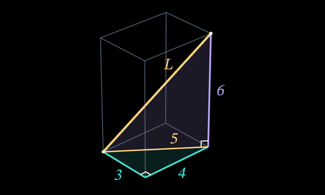
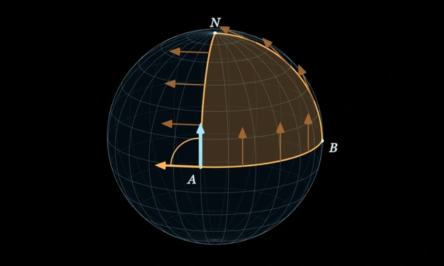
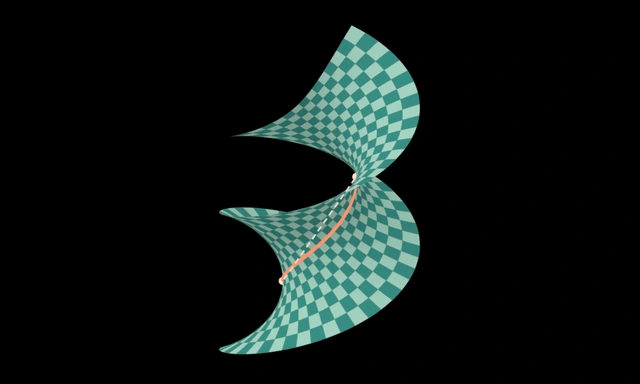
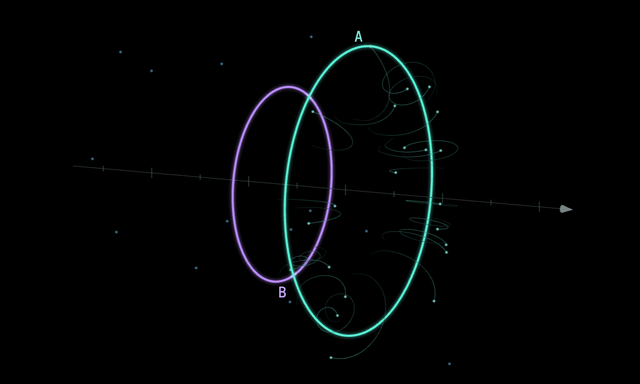
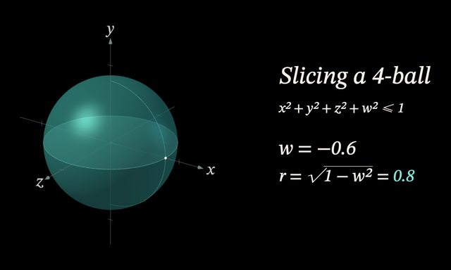
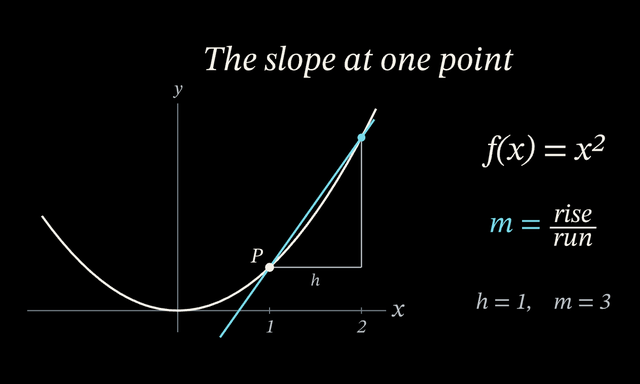
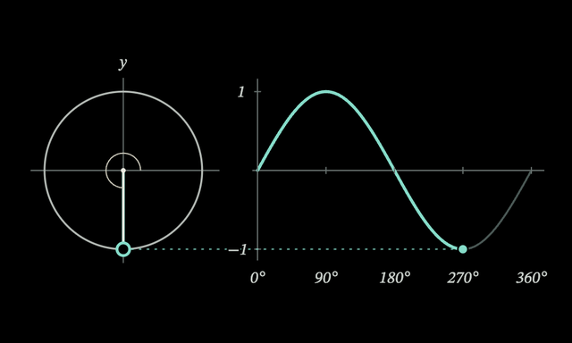
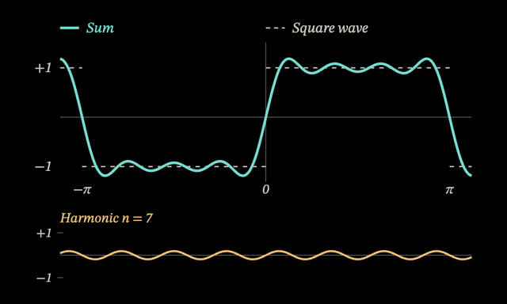
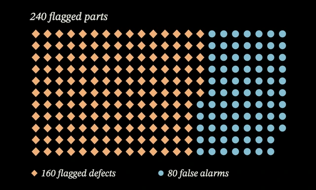
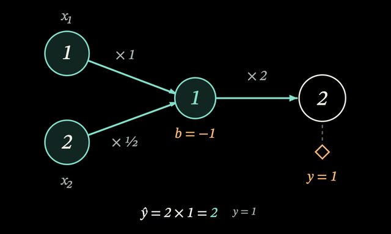

# Manim Blackboard

**English** · [简体中文](README.zh-CN.md)

Manim Blackboard is a skill you can install in any AI coding assistant that supports Agent Skills. Give your assistant a teaching topic and it creates an offline HTML lesson. Each click advances the animation by one step. [Browse the lessons](https://qxryz.github.io/manim-blackboard/examples/)

## Quick start

```text
Install the manim-blackboard skill from https://github.com/qxryz/manim-blackboard in the current project for your use, then verify that you can invoke it here.
```

To install it yourself, run this command in your project directory.

```sh
npx skills add qxryz/manim-blackboard --skill manim-blackboard
```

Choose your assistant when prompted. Try this lesson prompt.

> Use Manim Blackboard to show why the first n odd numbers add up to n². Add an L-shaped strip of tiles with each click. Include English and Chinese captions.

Open the generated HTML in your browser. Click or press **→** to advance, **←** to go back, **R** to replay a step, and **L** to toggle the translation.

The [skills/manim-blackboard](skills/manim-blackboard/) folder contains the instructions and tools your assistant uses to make lessons. In [examples](examples/), each lesson has a ready-to-open HTML file, a preview image and editable source. [Build an example from source](examples/README.md#rebuild-a-lesson)

## Examples

### [The space diagonal of a box](https://qxryz.github.io/manim-blackboard/examples/the-third-side/)

In a 3 × 4 × 6 box, the floor diagonal is 5 and becomes one leg of the triangle that gives the space diagonal, √61.

[](https://qxryz.github.io/manim-blackboard/examples/the-third-side/)

### [Parallel transport on a sphere](https://qxryz.github.io/manim-blackboard/examples/holonomy/)

Carry an arrow around a spherical triangle and see it return to the starting point turned through 90°.

[](https://qxryz.github.io/manim-blackboard/examples/holonomy/)

### [From helicoid to catenoid](https://qxryz.github.io/manim-blackboard/examples/associate-family/)

As a helicoid bends into a catenoid, a marked straight segment becomes a semicircle of the same length.

[](https://qxryz.github.io/manim-blackboard/examples/associate-family/)

### [Leapfrogging vortex rings](https://qxryz.github.io/manim-blackboard/examples/vortex-leapfrog/)

Follow two vortex rings as the trailing ring shrinks, passes through the leading ring and expands in front.

[](https://qxryz.github.io/manim-blackboard/examples/vortex-leapfrog/)

### [Slicing a 4D ball](https://qxryz.github.io/manim-blackboard/examples/four-ball/)

Sweep a slice through a 4D ball and watch its 3D cross-section grow from a point to a unit ball, then shrink to a point again.

[](https://qxryz.github.io/manim-blackboard/examples/four-ball/)

### [From secant to tangent](https://qxryz.github.io/manim-blackboard/examples/derivative/)

As two points on the parabola y = x² come together at x = 1, the secant turns toward the tangent and its slope approaches 2.

[](https://qxryz.github.io/manim-blackboard/examples/derivative/)

### [The unit circle and sine](https://qxryz.github.io/manim-blackboard/examples/unit-circle/)

Drag a point once around the unit circle and follow its height through one complete period of a sine wave.

[](https://qxryz.github.io/manim-blackboard/examples/unit-circle/)

### [Building a square wave](https://qxryz.github.io/manim-blackboard/examples/fourier/)

Add the third, fifth and seventh harmonics to a sine wave and watch the sum flatten between jumps and overshoot at the edges.

[](https://qxryz.github.io/manim-blackboard/examples/fourier/)

### [Bayes and the base rate](https://qxryz.github.io/manim-blackboard/examples/bayes/)

Lower the defect rate in a batch of 1,000 parts and watch false alarms account for a larger share of the scanner’s flags.

[](https://qxryz.github.io/manim-blackboard/examples/bayes/)

### [A neural network by hand, from gradients to attention](https://qxryz.github.io/manim-blackboard/examples/neural-network/)

Trace a prediction error backward through the weights of a small network, then work out how three tokens share attention.

[](https://qxryz.github.io/manim-blackboard/examples/neural-network/)

## License

Manim Blackboard is available under the [MIT License](LICENSE). The bundled fonts, libraries and adapted scenes have their own [third-party notices](THIRD_PARTY_NOTICES.md).
