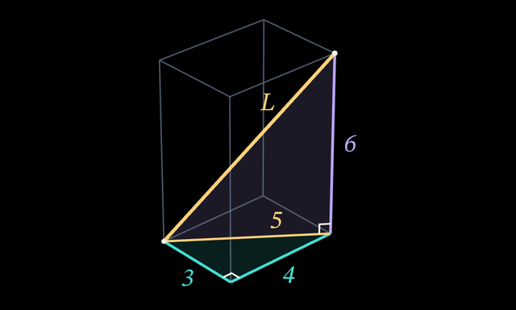
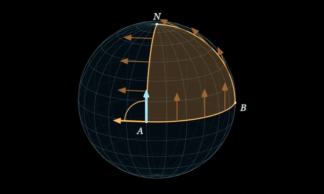
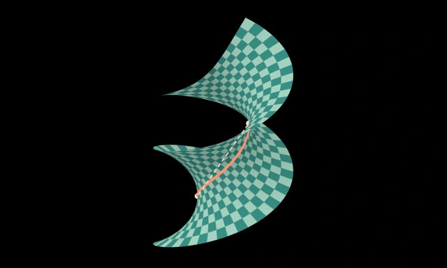
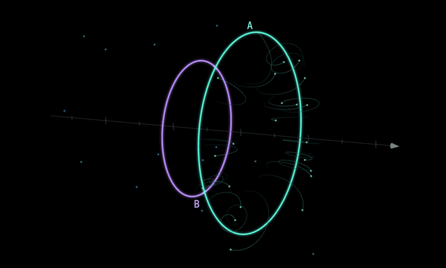
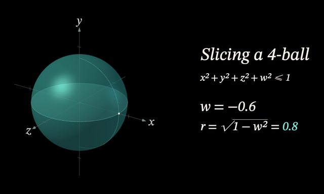
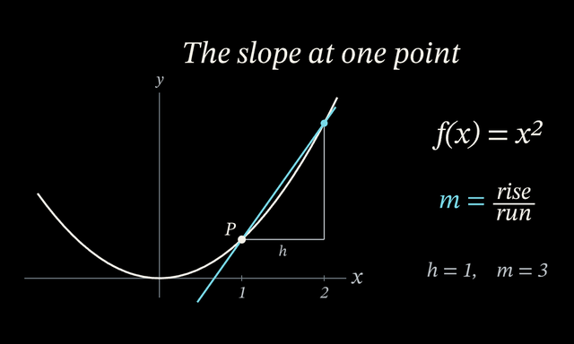
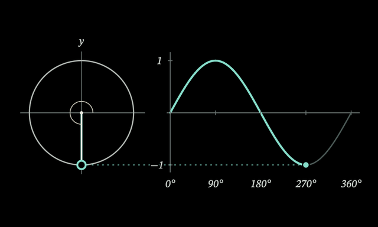
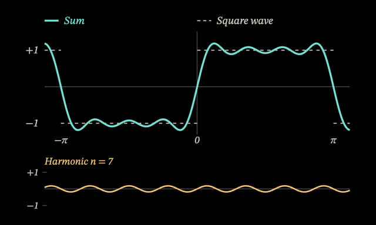
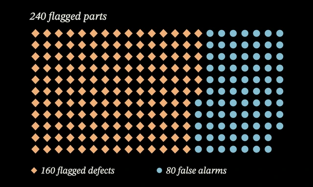
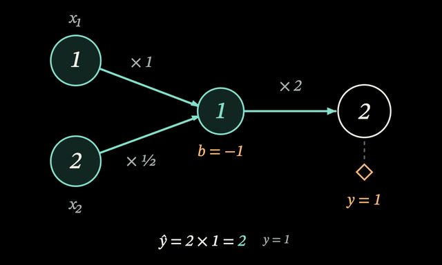

# 

[English](README.md) · **简体中文**

Manim Blackboard 是一项可安装到 AI 编程助手里的技能（skill），适用于支持 Agent Skills 的助手。给助手一个教学主题，它就能生成一份离线 HTML 动画课件，点击一次推进一步。[浏览全部课件](https://qxryz.github.io/manim-blackboard/examples/)

## 快速开始

```text
请从 https://github.com/qxryz/manim-blackboard 把 manim-blackboard 技能安装到当前项目，并验证你能在这个项目里调用它。
```

也可以在项目目录里手动运行安装命令。

```sh
npx skills add qxryz/manim-blackboard --skill manim-blackboard
```

按提示选择助手，然后试试这段提示词。

> 用 Manim Blackboard 解释前 n 个奇数之和为什么等于 n²。从一块方砖开始，每次点击都在正方形外侧添上一条 L 形砖带，配上中英字幕。

用浏览器打开生成的 HTML。点击或按 **→** 前进，按 **←** 返回，按 **R** 重播当前步骤，按 **L** 切换翻译字幕。

[skills/manim-blackboard](skills/manim-blackboard/) 存放助手制作课件时使用的指令和工具。[examples](examples/) 收录可直接打开的 HTML 课件，每课都附预览图和可编辑的源码。[从源码构建课件](examples/README.md#rebuild-a-lesson)

## 课件示例

### [长方体的空间对角线](https://qxryz.github.io/manim-blackboard/examples/the-third-side/#dual)

在 3 × 4 × 6 的长方体里，长为 5 的底面对角线和高组成第二个直角三角形，由此得到长为 √61 的空间对角线。

[](https://qxryz.github.io/manim-blackboard/examples/the-third-side/#dual)

### [球面上的平行移动](https://qxryz.github.io/manim-blackboard/examples/holonomy/#dual)

让箭头沿球面三角形绕行一周，回到起点时，它与出发方向恰好相差 90°。

[](https://qxryz.github.io/manim-blackboard/examples/holonomy/#dual)

### [从螺旋面到悬链面](https://qxryz.github.io/manim-blackboard/examples/associate-family/#dual)

螺旋面弯成悬链面时，面上标出的一条直线段随之弯成半圆弧，弧长仍等于原来的线段长。

[](https://qxryz.github.io/manim-blackboard/examples/associate-family/#dual)

### [交替穿行的涡环](https://qxryz.github.io/manim-blackboard/examples/vortex-leapfrog/#dual)

后方的涡环收缩，从前方涡环的中心穿过，再在前方扩张，两个涡环就这样轮流超前。

[](https://qxryz.github.io/manim-blackboard/examples/vortex-leapfrog/#dual)

### [四维球切片](https://qxryz.github.io/manim-blackboard/examples/four-ball/#dual)

沿第四个坐标移动切面，三维截面从一个点长成单位实心球，越过中心后又缩回一个点。

[](https://qxryz.github.io/manim-blackboard/examples/four-ball/#dual)

### [从割线到切线](https://qxryz.github.io/manim-blackboard/examples/derivative/#dual)

让抛物线 y = x² 上的两点在 x = 1 处靠近，观察割线转向切线，斜率逐渐趋近 2。

[](https://qxryz.github.io/manim-blackboard/examples/derivative/#dual)

### [单位圆与正弦](https://qxryz.github.io/manim-blackboard/examples/unit-circle/#dual)

沿单位圆拖动一点，让它转完一周，右侧正弦曲线便记录下它在整个周期里的高度。

[](https://qxryz.github.io/manim-blackboard/examples/unit-circle/#dual)

### [用正弦波合成方波](https://qxryz.github.io/manim-blackboard/examples/fourier/#dual)

依次叠加三次、五次和七次谐波，波形中段逐渐变平，跳变附近仍然留着过冲。

[](https://qxryz.github.io/manim-blackboard/examples/fourier/#dual)

### [贝叶斯与基准率](https://qxryz.github.io/manim-blackboard/examples/bayes/#dual)

调低一批 1,000 个零件中的次品率，观察扫描仪标记的零件里，误报所占的比例怎样上升。

[](https://qxryz.github.io/manim-blackboard/examples/bayes/#dual)

### [手推神经网络与自注意力](https://qxryz.github.io/manim-blackboard/examples/neural-network/#dual)

从预测误差反推小型网络各权重的梯度，再算出三个词元之间如何分配注意力。

[](https://qxryz.github.io/manim-blackboard/examples/neural-network/#dual)

## 许可证

Manim Blackboard 采用 [MIT 许可证](LICENSE)。随附字体、库及改编场景的许可和署名见[第三方声明](THIRD_PARTY_NOTICES.md)。
